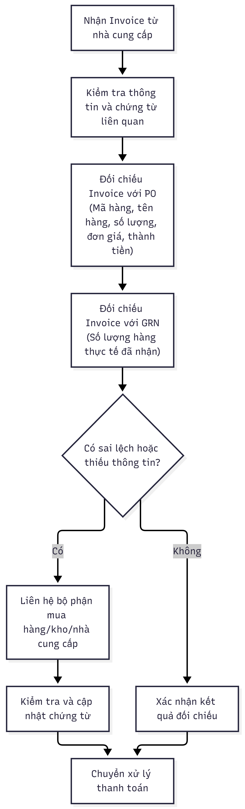

# Báo cáo nhóm — Day 02 Discovery & Problem Framing

> Bản chung của nhóm, viết trên repo do nhóm trưởng fork. Không copy file này sang repo cá nhân.
> Template chi tiết và prompt mẫu: [docs/01-worksheet.md](../../docs/01-worksheet.md). Bài mẫu: [docs/02-deliverable-example.md](../../docs/02-deliverable-example.md).

## 1. Thông tin nhóm

- Tên nhóm: I3
- Thành viên: xem `TEAM.md`
- Candidate problem được chọn (1 câu): Vendor Invoice Reconciliation
- Quyết định cuối: Go / Not Yet / No-Go

---

## 2. Hội tụ nhóm (CP3)

### 2.1. Pitch

|   # | Người đưa ra          | Candidate (Job Story ngắn)        | Actor                                                                                     | Bottleneck                                                                                                                                                                          | Câu hỏi phản biện nhận được (ai hỏi)                                                                                                                                                                                                                                    |
| --: | --------------------- | --------------------------------- | ----------------------------------------------------------------------------------------- | ----------------------------------------------------------------------------------------------------------------------------------------------------------------------------------- | ----------------------------------------------------------------------------------------------------------------------------------------------------------------------------------------------------------------------------------------------------------------------- |
|   1 | Trương Đặng Minh Khuê | Medical Knowledge Retrieval       | Bác sĩ điều trị                                                                           | Tìm kiếm, đọc và đối chiếu nhiều tài liệu liên quan đến bệnh lạ                                                                                                                     | Nếu AI cung cấp tài liệu y khoa sai hoặc lỗi thời, nhóm làm sao để đảm bảo độ tin cậy của thông tin? (Nguyễn Đình Nam)                                                                                                                                                  |
|   2 | Trương Đặng Minh Khuê | Medical Record Summarization      | Bác sĩ chẩn đoán hình ảnh                                                                 | Đọc, đối chiếu và tổng hợp nhiều hồ sơ bệnh án của một bệnh nhân                                                                                                                    | Nếu AI tóm tắt sai hoặc bỏ sót thông tin bệnh án, nhóm làm sao để đảm bảo độ chính xác? (Nguyễn Đình Nam)                                                                                                                                                               |
|   3 | Trương Đặng Minh Khuê | Pneumonia Detection on X-ray      | Bác sĩ chẩn đoán hình ảnh                                                                 | Quan sát và nhận diện các dấu hiệu bất thường cỡ nhỏ trên ảnh X-quang                                                                                                               | Nếu AI bỏ sót dấu hiệu viêm phổi hoặc nhận diện nhầm vùng phổi bình thường, nhóm xử lý thế nào để đảm bảo an toàn cho bệnh nhân? (Nguyễn Đình Nam)                                                                                                                      |
|   4 | Trịnh Tuấn Phong      | Quản lý việc và deadline phân tán | Sinh viên K5 vừa đi thực tập, tự quản lý cả lịch học và lịch làm                          | Bước 5–6 là bước duy nhất phải làm hoàn toàn bằng tay và là nơi xảy ra bỏ sót; sau đó không có bước kiểm tra lại nào trong ngày                                                     | Tháng vừa rồi bạn bỏ sót mấy deadline? Sót vì không biết hạn hay vì không kịp làm? (Triệu Quốc Khánh)                                                                                                                                                                   |
|   5 | Trịnh Tuấn Phong      | Đọc tài liệu dài và tổng hợp      | Sinh viên vừa học vừa đi làm, đọc tài liệu chuyên môn và bài báo hằng tuần                | Bước mở lại và đọc lại 5–8 nguồn, khoảng 45 phút/bản — vì ghi chú cũ quá sơ sài để viết được                                                                                        | Bạn đã xác minh rằng việc đọc lại và tổng hợp 5–8 nguồn tài liệu là một vấn đề phổ biến với sinh viên vừa học vừa làm chưa, hay đây chỉ là khó khăn từ thói quen ghi chú cá nhân? (Trương Đặng Minh Khuê)                                                               |
|   6 | Trịnh Tuấn Phong      | Soạn trả lời tin nhắn/email       | Sinh viên, trả lời tin nhắn của nhóm học, mentor và ban tổ chức CLB                       | Bước soạn, khoảng 8 phút trên tổng 15 phút — phải viết lại từ đầu mỗi lần vì không có mẫu sẵn                                                                                       | Với 5 tin/tuần, mỗi tin khoảng 15 phút, nếu đã có sẵn 3–5 mẫu trả lời cho các loại tin hay gặp và một checklist trước khi gửi thì có thật sự cần dùng AI không, hay chỉ cần sửa quy trình là đủ? (Trịnh Tuấn Phong)                                                     |
|   7 | Nguyễn Đình Nam       | Employee Onboarding Tracker       | HR điều phối chính; nhân viên mới, quản lý trực tiếp và IT cùng tham gia.                 | Theo dõi và nhắc các bên hoàn tất thủ tục, quyền truy cập và thiết bị: khoảng 30 phút/nhân viên.                                                                                    | Đã có Excel, phần mềm nhân sự hoặc nhắc về việc tự động hóa chưa, và nó thiếu gì? (Triệu Quốc Khánh)                                                                                                                                                                    |
|   8 | Nguyễn Đình Nam       | Travel Expense Claim Check        | Nhân viên đi công tác lập hồ sơ; quản lý phê duyệt; kế toán kiểm tra và xử lý thanh toán. | Kế toán kiểm tra chứng từ và xác định giấy tờ thiếu hoặc chưa hợp lệ: khoảng 5 phút/lượt kiểm tra (ước tính ban đầu, cần đo thực tế; chưa tính thời gian chờ bổ sung và phê duyệt). | Nếu việc kiểm tra chứng từ chỉ mất khoảng 5 phút/lượt, tần suất phát sinh hồ sơ có đủ lớn để justify chi phí phát triển và vận hành AI không? (Trương Đặng Minh Khuê)                                                                                                   |
|   9 | Nguyễn Đình Nam       | Vendor Invoice Reconciliation     | Kế toán kiểm tra chính; bộ phận mua hàng xác minh đơn đặt hàng và biên nhận.              | So sánh mã hàng, số lượng và đơn giá giữa các hồ sơ: khoảng 2 phút, trong tổng 5 phút/hóa đơn.                                                                                      | Phần mềm kế toán công ty đã có sẵn chức năng đối chiếu hóa đơn chưa? (Triệu Quốc Khánh)                                                                                                                                                                                 |
|  10 | Triệu Quốc Khánh      | Inventory Receipt Entry           | Nhân viên nhập liệu phụ trách phiếu nhập kho                                              | Bước tìm mã hàng + gõ số lượng + kiểm tra, khoảng 10 phút/phiếu (chiếm hơn 80% thời gian)                                                                                           | Trong 10 phút/phiếu, thời gian mất ở gõ số lượng hay ở việc tìm đúng mã hàng khi tên hàng trên phiếu không khớp danh mục? Nếu là do danh mục mã hàng lộn xộn thì chuẩn hóa danh mục và cho quét barcode/điền sẵn từ PO (rule) đã giải được 80% chưa? (Trịnh Tuấn Phong) |
|  11 | Triệu Quốc Khánh      | Monthly Spending Summary          | Bản thân (sinh viên dùng ví MoMo liên kết 2 tài khoản ngân hàng MB và VietinBank)         | Bước cộng tổng từ 3 nguồn. Các khoản chuyển giữa MoMo và ngân hàng xuất hiện ở cả 2 nơi nên dễ tính trùng, cuối cùng không ra được con số tổng chắc chắn                            | Các khoản chuyển giữa MoMo và ngân hàng khác nhau ở đâu? Số tiền, ngày, hay nội dung chuyển khoản? Nếu chỉ cần một rule khớp cặp giao dịch đối ứng để loại trùng là ra được con số tổng, thì phần nào thật sự buộc phải dùng AI? (Trịnh Tuấn Phong)                     |
|  12 | Triệu Quốc Khánh      | CV Tailoring                      | Sinh viên năm cuối đang ứng tuyển vị trí thực tập / việc làm                              | Bước sửa CV, khoảng 10–15 phút/lần, lâu nhất trong quy trình                                                                                                                        | Việc sử dụng AI để chỉnh sửa CV có khiến nội dung trở nên thiếu tính cá nhân hóa, giống các CV được tạo hàng loạt và làm giảm đánh giá của HR đối với ứng viên không? (Trương Đặng Minh Khuê)                                                                           |

### 2.2. Cluster

| Cluster                                | Các candidate                                                                                    | Pattern chung                                                                            |
| -------------------------------------- | ------------------------------------------------------------------------------------------------ | ---------------------------------------------------------------------------------------- |
| A — Medical Information & Analysis     | #1 Medical Knowledge Retrieval, #2 Medical Record Summarization, #3 Pneumonia Detection on X-ray | Hỗ trợ bác sĩ tìm kiếm, tổng hợp và phân tích thông tin y khoa để phục vụ chẩn đoán      |
| B — Information Management & Tracking  | #4 Quản lý việc và deadline phân tán, #7 Employee Onboarding Tracker                             | Thông tin và đầu việc phân tán qua nhiều nguồn, cần tổng hợp và theo dõi để tránh bỏ sót |
| C — Document Processing & Verification | #5 Đọc tài liệu dài và tổng hợp, #9 Vendor Invoice Reconciliation, #10 Inventory Receipt Entry   | Xử lý lượng lớn thông tin hoặc chứng từ, cần trích xuất, đối chiếu và tổng hợp thủ công  |
| D — Personal Productivity & Finance    | #6 Soạn trả lời tin nhắn/email, #11 Monthly Spending Summary, #12 CV Tailoring                   | Các công việc cá nhân lặp lại, cần xử lý hoặc điều chỉnh thông tin theo từng tình huống  |

### 2.3. Opportunity Solution Tree rút gọn

Gốc là **1 outcome**. Nhánh là **opportunity** (nhu cầu, pain), không phải tính năng hay công cụ.

```text
OUTCOME: Giảm thời gian kế toán cần để kiểm tra và đối chiếu thông tin hóa đơn, đồng thời hạn chế sai sót trong thanh toán.
├── Opportunity A:  Thông tin mã hàng, số lượng và đơn giá nằm ở nhiều chứng từ khác nhau (hóa đơn, đơn đặt hàng, biên nhận).
├── Opportunity B:  Kế toán phải kiểm tra và đối chiếu từng trường thông tin thủ công để phát hiện sự không khớp giữa các chứng từ.
└── Opportunity C:  Chưa rõ phần mềm kế toán hiện tại đã hỗ trợ đối chiếu hóa đơn hay chưa, dẫn đến chưa xác định được phần
                    công việc thực sự còn cần xử lý thủ công.
```

Những ý đã gạch bỏ vì là solution đội lốt opportunity:

- Tự động đối chiếu hóa đơn với PO và biên nhận (có thể dùng automation)
- AI phát hiện sai lệch giữa các chứng từ (Đây là AI cụ thể)
- Dashboard theo dõi trạng thái hóa đơn (Đây là giao diện hệ thống)
- Tích hợp OCR để trích xuất thông tin hóa đơn (Giải pháp dùng computer vision)

### 2.4. Chấm điểm shortlist (1–5)

| Candidate                         | Actor rõ | Quy trình rõ | Pain có bằng chứng | Impact đo được | Vừa sức lab | So sánh được No AI/Rule/Workflow/Agent | Nhóm hiểu domain | Tổng |
| --------------------------------- | -------: | -----------: | -----------------: | -------------: | ----------: | -------------------------------------: | ---------------: | ---: |
| Medical Knowledge Retrieval       |        5 |            4 |                  2 |              2 |           4 |                                      4 |                4 |   25 |
| Medical Record Summarization      |        5 |            4 |                  2 |              2 |           4 |                                      4 |                4 |   25 |
| Pneumonia Detection on X-ray      |        5 |            4 |                  3 |              3 |           3 |                                      4 |                4 |   26 |
| Quản lý việc và deadline phân tán |        5 |            5 |                  4 |              4 |           3 |                                      3 |                4 |   28 |
| Đọc tài liệu dài và tổng hợp      |        4 |            4 |                  4 |              4 |           4 |                                      4 |                4 |   28 |
| Soạn trả lời tin nhắn/email       |        4 |            4 |                  3 |              3 |           5 |                                      3 |                4 |   25 |
| Employee Onboarding Tracker       |        5 |            4 |                  3 |              3 |           3 |                                      4 |                3 |   25 |
| Travel Expense Claim Check        |        5 |            4 |                  3 |              3 |           4 |                                      4 |                3 |   26 |
| Vendor Invoice Reconciliation     |        5 |            5 |                  4 |              4 |           4 |                                      5 |                3 |   30 |
| Inventory Receipt Entry           |        4 |            4 |                  4 |              4 |           4 |                                      4 |                3 |   27 |
| Monthly Spending Summary          |        4 |            3 |                  2 |              2 |           4 |                                      3 |                5 |   23 |
| CV Tailoring                      |        4 |            4 |                  3 |              3 |           5 |                                      3 |                5 |   27 |

**Candidate được chọn:** Vendor Invoice Reconciliation

**Vì sao chọn:**

- Actor và quy trình rõ ràng cùng với Bottleneck cụ thể gồm đối chiếu mã hàng, số lượng và đơn giá giữa nhiều chứng từ.
- Có số liệu thời gian ban đầu (2/5 phút mỗi hóa đơn).
- Phù hợp để xây dựng prototype và so sánh 4 mức No AI/Rule/Workflow/Agent.

**Vì sao loại các candidate còn lại:**

- Một số bài toán thiếu bằng chứng về pain và impact, trong khi một số có thể giải quyết bằng workflow hoặc công cụ thông thường, chưa cần AI.
- Một số cần dữ liệu chuyên ngành hoặc tích hợp hệ thống phức tạp.
- Một số có phạm vi rộng hoặc impact chưa đủ rõ.

**Xử lý bất đồng (nếu có):**

- Các thành viên lúc đầu chưa thống nhất hoặc còn nhầm lẫn về cách hiểu quy trình đối chiếu hóa đơn, đặc biệt là phân biệt giữa số tiền được duyệt, số tiền đã thanh toán và số tiền còn lại.
- Nhóm cần làm rõ quy trình nghiệp vụ trước khi xác định giải pháp.

---

## 3. Kiểm chứng + research giải pháp đã có (CP4)

### 3.1. Assumption Map

|   # | Giả định                                                                                                      | Loại (Value / Usability / Feasibility / Viability) | Quan trọng (1–5) | Đã có bằng chứng (1–5) | Kiểm chứng trước? |
| --: | ------------------------------------------------------------------------------------------------------------- | -------------------------------------------------- | ---------------: | ---------------------: | ----------------- |
|   1 | Kế toán thực sự mất nhiều thời gian đối chiếu thủ công giữa invoice, PO và phiếu nhận hàng.                   | Value                                              |                5 |                      2 | Có                |
|   2 | Sai lệch về mã hàng, số lượng hoặc đơn giá có thể gây chậm trễ hoặc sai sót trong thanh toán.                 | Value                                              |                5 |                      2 | Có                |
|   3 | Phần mềm kế toán hiện tại chưa hỗ trợ đầy đủ việc đối chiếu giữa các chứng từ này.                            | Value                                              |                5 |                      1 | Có                |
|   4 | Thông tin trên invoice, PO và phiếu nhận hàng có thể trích xuất để tự động so sánh.                           | Feasibility                                        |                4 |                      2 | Có                |
|   5 | Kế toán có thể dễ dàng kiểm tra và xác nhận các sai lệch mà hệ thống phát hiện.                               | Usability                                          |                4 |                      1 | Có                |
|   6 | Công ty cho phép sử dụng công cụ xử lý dữ liệu chứng từ nội bộ và có thể triển khai trong quy trình hiện tại. | Viability                                          |                5 |                      1 | Có                |

Giả định nhóm kiểm chứng trong buổi này:

1. Kế toán mất nhiều thời gian đối chiếu thủ công giữa invoice, PO và phiếu nhận hàng.
2. Phần mềm kế toán hiện tại chưa hỗ trợ đầy đủ việc đối chiếu này.
3. Sai lệch giữa các chứng từ gây ra công việc bổ sung hoặc chậm thanh toán.

### 3.2. Kiểm chứng

Cách đã dùng: Phỏng vấn / Survey / Log, ticket, review

Interview snapshot (mỗi buổi phỏng vấn một bảng, hoặc đặt file trong `report/assets/cp4-interview-snapshot-N.md`):

**Interview snapshot 1** (Trương Đặng Minh Khuê)

| Trường                                            | Nội dung                                                                                  |
| ------------------------------------------------- | ----------------------------------------------------------------------------------------- |
| Người được hỏi (vai trò, không ghi tên thật)      | Kế toán công ty                                                                           |
| Câu nói đáng nhớ nhất (nguyên văn)                | "Thời gian kiểm tra hóa đơn tùy thuộc vào giá trị hóa đơn, mặt hàng..."                   |
| Lần gần nhất gặp vấn đề này: chuyện gì đã xảy ra? | Đã từng gặp chứng từ sai lệch, phải hủy chứng từ và làm lại cho đúng.                     |
| Hiện đang xử lý bằng cách nào (workaround)?       | Sử dụng phần mềm FAST, nhưng vẫn có thao tác nhập dữ liệu và diễn giải nội dung thủ công. |
| Mất bao lâu, bao lần?                             | Chưa có số liệu cụ thể; thời gian phụ thuộc giá trị hóa đơn và mặt hàng.                  |
| Insight / opportunity rút ra                      | Sai lệch chứng từ gây thêm công việc xử lý và có thể làm chậm tiến độ.                    |

**Interview snapshot 2** (Triệu Quốc Khánh)

| Trường                                            | Nội dung                                                                                       |
| ------------------------------------------------- | ---------------------------------------------------------------------------------------------- |
| Người được hỏi (vai trò, không ghi tên thật)      | Nhân viên chăm sóc khách hàng                                                                  |
| Câu nói đáng nhớ nhất (nguyên văn)                | "Quy trình so lô, hạn dùng thực tế với hóa đơn là mất thời gian và dễ sai sót nhất."           |
| Lần gần nhất gặp vấn đề này: chuyện gì đã xảy ra? | Phải kiểm tra từng sản phẩm và đối chiếu thông tin lô, hạn dùng.                               |
| Hiện đang xử lý bằng cách nào (workaround)?       | Sử dụng phần mềm MISA, nhưng các bước kiểm tra vẫn thực hiện thủ công.                         |
| Mất bao lâu, bao lần?                             | Khoảng 5 phút/hóa đơn, 15 hóa đơn/tuần.                                                        |
| Insight / opportunity rút ra                      | Việc kiểm tra chi tiết từng sản phẩm, đặc biệt là lô và hạn dùng, tốn thời gian và dễ sai sót. |

**Interview snapshot 3** (Trịnh Tuấn Phong)

| Trường                                            | Nội dung                                                                                                                                                                        |
| ------------------------------------------------- | ------------------------------------------------------------------------------------------------------------------------------------------------------------------------------- |
| Người được hỏi (vai trò, không ghi tên thật)      | Người có kinh nghiệm đối chiếu chứng từ (cần xác nhận chức danh)                                                                                                                |
| Câu nói đáng nhớ nhất (nguyên văn)                | "Phần tốn thời gian nhất không phải là kiểm tra phép tính mà là đối chiếu thông tin giữa nhiều chứng từ khác nhau."                                                             |
| Lần gần nhất gặp vấn đề này: chuyện gì đã xảy ra? | Đã gặp các trường hợp đơn giá sai lệch, mã hàng không khớp, hóa đơn trùng hoặc thông tin nhà cung cấp không chính xác.                                                          |
| Hiện đang xử lý bằng cách nào (workaround)?       | Sử dụng MISA và Excel; kiểm tra chứng từ, xác minh sai lệch và liên hệ bộ phận mua hàng, kho hoặc nhà cung cấp.                                                                 |
| Mất bao lâu, bao lần?                             | Hóa đơn đơn giản: 3–5 phút; nhiều mặt hàng: 10–20 phút; có sai lệch hoặc thiếu chứng từ: 30 phút đến vài giờ. Chưa rõ tần suất.                                                 |
| Insight / opportunity rút ra                      | Đối chiếu thông tin giữa Invoice, PO và GRN là bottleneck chính, đặc biệt khi mã hàng không đồng nhất hoặc chứng từ thiếu. Sai lệch còn khiến quy trình thanh toán bị trì hoãn. |

**Interview snapshot 4** (Trịnh Tuấn Phong)

| Trường                                            | Nội dung                                                                                                                             |
| ------------------------------------------------- | ------------------------------------------------------------------------------------------------------------------------------------ |
| Người được hỏi (vai trò, không ghi tên thật)      | Người có kinh nghiệm kiểm tra hóa đơn đầu vào (cần xác nhận chức danh)                                                               |
| Câu nói đáng nhớ nhất (nguyên văn)                | "Công đoạn tốn thời gian nhất là đối chiếu từng mã hàng, số lượng và đơn giá giữa các chứng từ."                                     |
| Lần gần nhất gặp vấn đề này: chuyện gì đã xảy ra? | Đã gặp sai mã hàng, chênh lệch số lượng hoặc đơn giá giữa hóa đơn và PO.                                                             |
| Hiện đang xử lý bằng cách nào (workaround)?       | Sử dụng phần mềm kế toán và Excel; liên hệ bộ phận mua hàng hoặc nhà cung cấp để xác minh, điều chỉnh sai lệch.                      |
| Mất bao lâu, bao lần?                             | Khoảng 5–10 phút/hóa đơn đơn giản; hóa đơn nhiều mặt hàng mất lâu hơn. Chưa rõ tần suất.                                             |
| Insight / opportunity rút ra                      | Đối chiếu thủ công giữa nhiều chứng từ vẫn tốn thời gian; sai lệch khiến quy trình xác minh kéo dài và ảnh hưởng tiến độ thanh toán. |

Tổng hợp:

| Nguồn     | Số người / số mẫu | Tín hiệu xác nhận                                                                                                                                                                                       | Tín hiệu phản bác                                                                                                      |
| --------- | ----------------: | ------------------------------------------------------------------------------------------------------------------------------------------------------------------------------------------------------- | ---------------------------------------------------------------------------------------------------------------------- |
| Phỏng vấn |                 4 | Cả 4 ghi nhận có thao tác thủ công. Nhiều người xác nhận việc đối chiếu mã hàng, số lượng, đơn giá giữa các chứng từ tốn thời gian. Sai lệch có thể khiến phải xác minh, điều chỉnh và chậm thanh toán. | Thời gian kiểm tra phụ thuộc độ phức tạp hóa đơn. MISA, FAST, phần mềm kế toán và Excel vẫn hỗ trợ một phần quy trình. |

**Nhóm đã sửa problem thế nào sau kiểm chứng:**
Nhóm thu hẹp từ việc tự động hóa toàn bộ quy trình Vendor Invoice Reconciliation thành:

Hỗ trợ đối chiếu thông tin chi tiết giữa Invoice, PO và Goods Receipt Note (GRN), phát hiện sai lệch về mã hàng, số lượng, đơn giá và chuyển các trường hợp bất thường cho nhân viên xác minh.

Lý do:

- Phỏng vấn xác nhận việc đối chiếu nhiều chứng từ vẫn tốn thời gian.
- Sai lệch khiến nhân viên phải xác minh, điều chỉnh và có thể trì hoãn thanh toán.
- Phần mềm hiện tại đã hỗ trợ một phần quy trình, nên nhóm tập trung vào khoảng trống còn lại thay vì thay thế toàn bộ phần mềm kế toán.

### 3.3. Research giải pháp đã có

| Công cụ / case / pattern                    | Link                                                                                                                            | Giải bước nào trong quy trình?                                  | Điểm mạnh                                                     | Khoảng trống / rủi ro                                                                | Bài học cho nhóm                                                                              |
| ------------------------------------------- | ------------------------------------------------------------------------------------------------------------------------------- | --------------------------------------------------------------- | ------------------------------------------------------------- | ------------------------------------------------------------------------------------ | --------------------------------------------------------------------------------------------- |
| MISA AMIS Kế toán                           | https://helpact.misa.vn/kb/giai-thich-y-nghia-va-cac-chuc-nang-co-trong-phan-he-mua-hang/?utm_source=chatgpt.com                | Quản lý PO, nhận hàng, hóa đơn đầu vào và chứng từ mua hàng.    | Các nghiệp vụ mua hàng được liên kết trong cùng hệ thống.     | Chưa xác minh được mức độ tự động đối chiếu chi tiết từng dòng hàng giữa 3 chứng từ. | Không nên xây lại toàn bộ chức năng quản lý mua hàng.                                         |
| MISA ASP                                    | https://helpasp.misa.vn/accounting/kb/quan-ly-hoa-don-dau-vao/?utm_source=chatgpt.com                                           | Đồng bộ, nhập và tự động hạch toán hóa đơn đầu vào.             | Hỗ trợ nhập hóa đơn từ XML/PDF và giảm thao tác nhập liệu.    | Tự động hạch toán không đồng nghĩa với tự động đối chiếu đầy đủ Invoice–PO–GRN.      | Cần tập trung vào đối chiếu và phát hiện sai lệch.                                            |
| FAST Accounting                             | https://fa12help.fast.com.vn/index.php/fa12help/mua-hang-va-cong-no-phai-tra/?utm_source=chatgpt.com                            | Quản lý đơn hàng, nhập hàng mua và hóa đơn đầu vào.             | Hỗ trợ nhiều nghiệp vụ mua hàng và theo dõi công nợ.          | Chưa xác minh được khả năng tự động matching 3 bên theo từng dòng hàng.              | Cần tìm hiểu những bước người dùng FAST vẫn phải làm thủ công.                                |
| Microsoft Dynamics 365 – Three-way Matching | https://learn.microsoft.com/en-us/dynamics365/finance/accounts-payable/accounts-payable-invoice-matching?utm_source=chatgpt.com | Đối chiếu Invoice, PO và Product Receipt; phát hiện chênh lệch. | Có cơ chế matching và cảnh báo sai lệch theo ngưỡng thiết lập | Cần cấu hình quy tắc; các trường hợp ngoại lệ vẫn cần con người xử lý.               | Có thể tham khảo mô hình tự động đối chiếu và chỉ chuyển trường hợp bất thường cho nhân viên. |

---

## 4. Quy trình trước/sau (CP5)

### 4.1. Quy trình hiện tại

Sơ đồ (ASCII, Mermaid hoặc link ảnh trong `report/assets/`):

```text

```

| Bước | Actor                                           | Input                                      | Output                                  | Thời gian / tần suất                                                      | Ghi chú                                                    |
| ---: | ----------------------------------------------- | ------------------------------------------ | --------------------------------------- | ------------------------------------------------------------------------- | ---------------------------------------------------------- |
|    1 | Kế toán                                         | Invoice từ nhà cung cấp                    | Invoice tiếp nhận                       | Chưa có dữ liệu cụ thể                                                    | Tiếp nhận hóa đơn và chứng từ liên quan                    |
|    2 | Kế toán                                         | Invoice, PO, GRN                           | Bộ chứng từ được kiểm tra               | Chưa có dữ liệu cụ thể                                                    | Kiểm tra thông tin và tính đầy đủ của chứng từ             |
|    3 | Kế toán                                         | Invoice và PO                              | Kết quả đối chiếu                       | Nằm trong tổng thời gian xử lý                                            | So sánh mã hàng, tên hàng, số lượng, đơn giá và thành tiền |
|    4 | Kế toán                                         | Invoice và GRN                             | Kết quả đối chiếu                       | Nằm trong tổng thời gian xử lý                                            | Kiểm tra số lượng trên hóa đơn so với hàng thực nhận       |
|    5 | Kế toán; phối hợp với mua hàng/kho/nhà cung cấp | Các thông tin sai lệch hoặc chứng từ thiếu | Thông tin được xác minh/cập nhật        | Có thể kéo dài từ 30 phút đến vài giờ khi có sai lệch hoặc thiếu chứng từ | Phải kiểm tra lại và liên hệ các bên liên quan             |
|    6 | Kế toán                                         | Kết quả đối chiếu cuối cùng                | Hồ sơ được chuyển sang xử lý thanh toán | Chưa có dữ liệu cụ thể                                                    | Chỉ tiếp tục khi thông tin đã được xác minh                |

**Bottleneck chính:**
Kế toán phải đối chiếu thủ công thông tin giữa ba loại chứng từ (Invoice, PO và GRN), đặc biệt là mã hàng, số lượng và đơn giá. Khi phát hiện sai lệch hoặc thiếu chứng từ, kế toán phải kiểm tra lại và phối hợp với các bộ phận liên quan, làm tăng thời gian xử lý và có thể ảnh hưởng đến tiến độ thanh toán.

Thời gian xử lý tham khảo từ phỏng vấn:

- Hóa đơn đơn giản: khoảng 3–5 phút hoặc 5–10 phút.
- Hóa đơn có nhiều mặt hàng: khoảng 10–20 phút.

Trường hợp có sai lệch hoặc thiếu chứng từ: có thể kéo dài từ 30 phút đến vài giờ.

Các con số trên là thời gian được người được phỏng vấn chia sẻ, chưa phải kết quả đo trung bình trên một tập hóa đơn thống nhất.

### 4.2. Quy trình tương lai

Ghi rõ bước nào **Rule**, bước nào **AI**, bước nào **con người**, **boundary** ở đâu, **phương án quay về** khi AI sai.

```text

```

### 4.3. Before / after

| Chỉ số               | Trước | Sau (kỳ vọng) | Ghi chú |
| -------------------- | ----: | ------------: | ------- |
| Số bước              |       |               |         |
| Tổng thời gian       |       |               |         |
| Số bước thủ công     |       |               |         |
| Bottleneck chính     |       |               |         |
| Rủi ro mới phát sinh |       |               |         |

---

## 5. Problem Statement v0 (CP5)

| Trường                                                                     | Nội dung |
| -------------------------------------------------------------------------- | -------- |
| **Actor**                                                                  |          |
| **Quy trình**                                                              |          |
| **Bottleneck**                                                             |          |
| **Impact**                                                                 |          |
| **Success Metric** (baseline → target, cách đo)                            |          |
| **Boundary** (AI không được làm gì; khi nào cần con người kiểm tra — HITL) |          |

Phản biện nhận được (từ AI hoặc nhóm khác) và nhóm có đồng ý không:

- ***

## 6. Mức can thiệp AI (CP6)

### 6.1. Ma trận độ mơ hồ × độ phức tạp

Bài của nhóm nằm ở ô:

Vì sao:

### 6.2. So sánh 4 mức

| Mức                       | Phương án cho bài của nhóm | Đủ khi nào | Rủi ro | Chọn? |
| ------------------------- | -------------------------- | ---------- | ------ | ----- |
| **No AI** (sửa quy trình) |                            |            |        |       |
| **Rule**                  |                            |            |        |       |
| **Workflow**              |                            |            |        |       |
| **Agent**                 |                            |            |        |       |

**Mức chọn:**

**Vì sao không chọn mức đơn giản hơn:**

### 6.3. AI Canvas rút gọn

| Thành phần                                                        | Nội dung |
| ----------------------------------------------------------------- | -------- |
| **Prediction** — AI dự đoán / tạo ra gì?                          |          |
| **Judgment** — con người cân nhắc, quyết định gì?                 |          |
| **Action** — hành động cuối cùng là gì, ai làm?                   |          |
| **Outcome** — đo kết quả bằng gì?                                 |          |
| **Input** — AI cần dữ liệu đầu vào gì mỗi lần chạy? Có sẵn không? |          |
| **Feedback** — lấy phản hồi ở đâu để cải thiện?                   |          |

### 6.4. Hai câu hỏi của Google PAIR

- Người dùng muốn **được hỗ trợ (augment)** hay **giao hẳn việc (automate)**? Bằng chứng:
- AI sai kiểu nào tệ hơn, **báo nhầm** hay **bỏ sót**? Vì sao, và thiết kế đã xử lý thế nào:

---

## 7. Problem Statement v1 + tiêu chí đánh giá (CP6)

| Trường                                          | Nội dung                        |
| ----------------------------------------------- | ------------------------------- |
| **Actor**                                       |                                 |
| **Quy trình**                                   |                                 |
| **Bottleneck**                                  |                                 |
| **Impact**                                      |                                 |
| **Success Metric** (baseline → target, cách đo) |                                 |
| **Boundary**                                    |                                 |
| **AI intervention point**                       |                                 |
| **Mức chọn**                                    | No AI / Rule / Workflow / Agent |
| **Rủi ro & người kiểm tra**                     |                                 |

**Thay đổi so với v0 và lý do:**

| Trường | v0  | v1  | Vì sao đổi |
| ------ | --- | --- | ---------- |
|        |     |     |            |

**Tiêu chí đánh giá đầu ra của AI (3–5 tiêu chí):**

|   # | Tiêu chí | Đạt khi | Không đạt khi |
| --: | -------- | ------- | ------------- |
|   1 |          |         |               |
|   2 |          |         |               |
|   3 |          |         |               |

---

## 8. Quyết định (CP6)

### 8.1. Bốn rủi ro

| Rủi ro          | Câu hỏi                                                           | Mức độ rủi ro (Thấp = an toàn / TB / Cao = nguy hiểm) | Lý do / bằng chứng |
| --------------- | ----------------------------------------------------------------- | ----------------------------------------------------- | ------------------ |
| **Value**       | Người dùng có thật sự cần và sẽ dùng không?                       |                                                       |                    |
| **Usability**   | Người dùng có dùng được, có hiểu và sửa được đầu ra của AI không? |                                                       |                    |
| **Feasibility** | Có đủ dữ liệu, công cụ, kỹ năng để làm không?                     |                                                       |                    |
| **Viability**   | Có hợp chi phí, pháp lý, quy định tổ chức không? Ai vận hành?     |                                                       |                    |

### 8.2. Kết luận

**Quyết định:** Go / Not Yet / No-Go

**Lý do:**

**Nếu Go — pilot nhỏ nhất:**

**Nếu Not Yet — cần kiểm chứng gì trước:**

**Nếu No-Go — nên làm gì thay AI:**

**Ngưỡng dừng** (nếu sau … mà … thì quay về …):

---

## 9. Hạn chế và hướng tiếp theo

-

## 10. Tài liệu tham khảo

-
